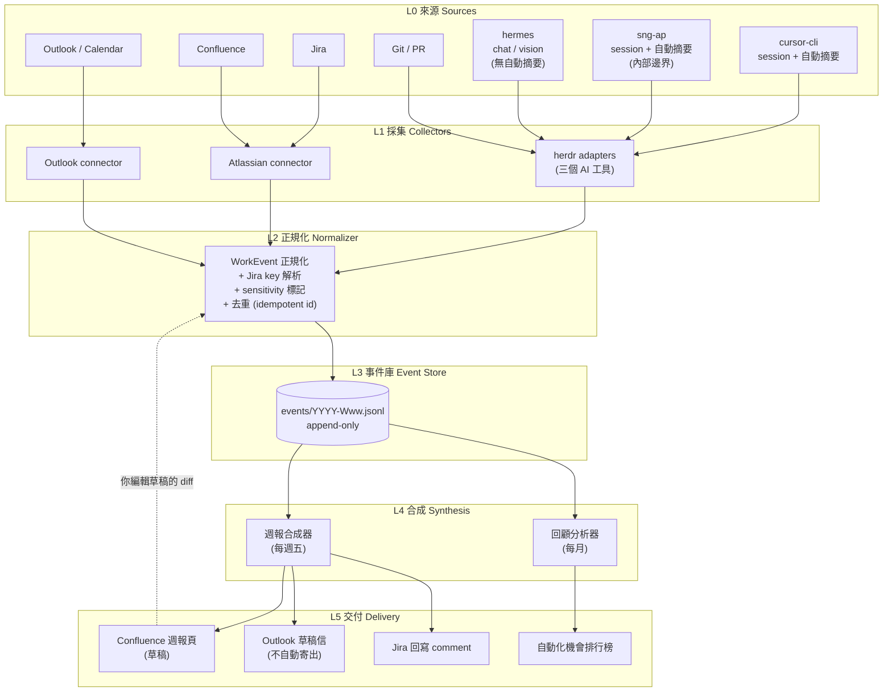

# 系統架構設計：AI 工作流事件層與週報自動化

## 0. 這份設計要解決什麼

你目前的狀況：

- 三個 AI 工具（`cursor-cli`、`hermes`、`sng-ap`）各自持有一部分「你這週實際做了什麼」的證據。
- Jira / Confluence 持有「應該做什麼」與「決策紀錄」。
- Outlook / Atlassian 每週推送更新，但那是**別人的**進度，不是你的。
- 週報要靠人腦把上面全部重新回想一次 —— 這是每週固定的一段 toil，而且回想品質隨時間衰減。

核心問題不是「缺資料」，而是**資料分散且沒有共同的關聯鍵（correlation key）**。
所以架構的第一原則是：

> **先把所有來源正規化成同一種事件（WorkEvent），用 Jira issue key 當唯一關聯鍵；週報只是這個事件流的一種投影（projection）。**

第二個目標「找長期進步 / 自動化機會」，不應該事後從 log 挖 —— 挖不出來。
應該在**事件發生當下就記一筆 friction**，讓它成為事件流的一等公民。這是本設計的第二原則。

### 前提假設（若與實情不符請告訴我，會影響 L1 設計）

- `herdr` 是既有的整合層，能取得三個工具的 session / 摘要，是 L1 的主要採集入口。
- `hermes` 的 200/月是**請求數**配額。
- `sng-ap` 為內部工具、無外網存取，其產出預設帶內部敏感度。

---

## 1. 分層架構



### 各層職責

| 層 | 職責 | 不該做的事 |
|---|---|---|
| L0 來源 | 產生原始紀錄 | — |
| L1 採集 | 只做取得與傳輸，保留原文 | 不做摘要、不做判斷 |
| L2 正規化 | 對映 schema、解析 Jira key、標記敏感度、去重 | 不做跨事件推論 |
| L3 事件庫 | append-only 存放，可重放 | 不可就地修改（更正用新事件覆寫） |
| L4 合成 | 唯一使用 LLM 做推論的地方 | 不直接讀 L0 原始 log |
| L5 交付 | 產草稿、等人審 | **不自動寄信、不自動發佈** |

**為什麼 L4 是唯一用 LLM 的地方**：如果每一層都讓模型自由發揮，錯誤會層層放大且無法歸因。L1/L2 保持確定性（deterministic），事件庫就可以重放；週報產得不好時，你改的是 L4 的 prompt，而不是重跑整條資料鏈。

---

## 2. 正規化事件模型（WorkEvent）

完整 schema 見 [`docs/schema/work-event.schema.json`](schema/work-event.schema.json)。核心欄位：

```jsonc
{
  "id": "sha256(source|native_id)",     // 冪等，重跑不會重複
  "ts": "2026-08-21T14:12:00+08:00",
  "source": "cursor | hermes | sng-ap | jira | confluence | outlook | git",
  "type": "ai_session | commit | pr | issue_transition | doc_edit | mail_thread | meeting",
  "keys": { "jira": ["ABC-123"], "repo": "svc-foo", "branch": "feat/ABC-123-retry" },
  "title": "為 retry 機制加上 backoff",
  "summary": "…（來自工具自動摘要，或你的收尾三行）",
  "artifacts": [{ "kind": "pr", "url": "…" }],
  "effort_min": 45,
  "outcome": "done | wip | blocked | abandoned",
  "friction": [{ "kind": "rework|waiting|manual-toil|context-switch|tool-gap",
                 "minutes": 25, "note": "手動比對三份 log" }],
  "sensitivity": "public | internal | restricted"
}
```

### 三個關鍵設計決定

**(a) `keys.jira` 是整個系統的支點。**
沒有 Jira key 的事件會落入 `unassigned` 桶，週報只能寫成「其他雜項」。所以最高槓桿的習慣改變是：分支名、commit、AI session 開場白、Confluence 頁面標題**一律帶 Jira key**（見 [使用習慣](02-usage-habits.md)）。這一項做到，週報品質立刻跳一階，比任何自動化都有效。

**(b) `friction` 是「找自動化機會」的唯一可靠來源。**
事後從 log 反推「哪裡浪費時間」幾乎必然失敗，因為浪費時間的事往往不留痕跡（等人回覆、手動搬資料、重複貼 context）。所以要在當下記。記錄成本必須極低 —— 一句話 + 一個分類，其餘由 L2 補齊。

**(c) `sensitivity` 決定資料能流到哪裡。**
`sng-ap` 是內部工具且無外網，它產生的事件預設 `internal`。這代表：

- L4 週報合成若在外部環境執行，**只能拿到該事件的 `title` + `keys` + `outcome`，不能拿 `summary` 全文**。
- 或者整條 L2–L4 都跑在內部邊界內，只有最終週報成品出去。

**建議選後者**：把 normalizer 與合成器放在內部環境，對外只交付成品。這樣才不用在每個欄位上做裁切邏輯，長期維護成本低很多。這是本架構唯一的硬性合規約束，先決定它，其餘都好辦。

---

## 3. 三個工具的路由策略

三個工具能力重疊但約束完全不同，若沒有明確路由規則，實際結果會是「順手就用手邊那個」，然後 hermes 額度在月中就燒完。

| 工具 | 決定性約束 | 預設用途 | 明確不要用它做 |
|---|---|---|---|
| **sng-ap**<br/>(opus 4.8 + KA) | 內部限定、**無外網工具**、配額未定 | 內部程式碼、內部知識查詢（KA 是它的獨佔優勢）、任何碰到專有資訊的工作 | 需要查外部文件、新版套件用法、公開 API 規格 |
| **cursor-cli**<br/>(opus 4.5 等) | 可外網、IDE 整合 | 外部 / OSS 程式碼、需要查外部資料的開發、大範圍重構 | 貼內部專有程式碼進去 |
| **hermes**<br/>(sonnet 4.6 / Gemini 3.1 Pro / vision) | **200 次/月 硬上限** | ①vision（截圖、圖表、UI、掃描件）②超長文件消化（Gemini 長 context）③關鍵決策的第二意見 | 日常寫扣、重複性小問題 —— 這些用 AP 或 cursor |

### hermes 額度預算

200/月 ÷ 約 21 個工作天 ≈ **9–10 次/日**，實務上建議按週配：

- 每週預算 **45 次**，保留 20 次/月做月底緩衝。
- 分配：vision / 圖表類 ~20、長文件消化 ~15、第二意見 ~10。
- 若某週用超過 60，L4 應在週報的「工具使用」段落標記出來。
- **hermes 是唯一沒有自動摘要的工具** → 它的事件必須靠你的收尾三行或 herdr 主動補抓，否則週報會系統性低估你在 hermes 上的產出。這是目前架構最明顯的一個漏點。

### 一句話決策樹

> 碰到內部程式碼或內部知識 → **sng-ap**；需要看圖或吞長文件 → **hermes**；其餘寫扣 → **cursor-cli**。

---

## 4. 週報產生流程

**觸發**：每週五 16:00（cron）。窗口為週一 00:00 → 週五 17:00。

1. **收集**：從 L3 撈窗口內全部事件。
2. **分群**：Jira Epic → Issue → 事件。無 key 者進 `unassigned`。
3. **合成**：每群產出四段 —— 進度 / 產出（PR、文件連結）/ 阻塞 / 下週計畫。
4. **寫入 Confluence**：使用固定 anchor 的模板（見 [`docs/templates/weekly-report.md`](templates/weekly-report.md)），標記為草稿。
5. **Outlook 草稿**：產草稿信，**不自動寄出**。
6. **Jira 回寫**：對本週有進展的 issue 貼一則簡短 comment（可選，先關閉）。
7. **你審稿**：目標 10 分鐘內。你的編輯 diff 回饋給 L2，作為下一輪 prompt 調校依據。

模板使用**固定標題 anchor**，這樣週與週之間可以做 diff，「上週說要做、這週沒動」的項目才能被自動抓出來 —— 這是週報真正的價值所在，而不是流水帳。

---

## 5. 自動化機會分析（每月）

輸入：當月全部 `friction` 記錄 + 工具使用統計 + 週報 diff（承諾 vs 實際）。

排序公式：

```
價值分數 = (月發生次數 × 每次分鐘數 × 12) / 預估建置人日
```

輸出一張排行榜，每項含：現象、觸發頻率、年省時數、建議做法、預估成本。
只挑**分數最高的 1 項**動手，做完再看下一輪 —— 同時開三個自動化專案，通常三個都做不完。

可預期會浮上來的前幾名（依你描述推測）：
1. 週報彙整本身（本設計 Phase 1 即解決）
2. 跨工具重複貼 context（→ 共用的 project brief 檔）
3. Atlassian / Outlook 每週更新的人工篩讀（→ 只留與你 Jira key 相關者）

---

## 6. 風險與取捨

| 風險 | 對策 |
|---|---|
| **過度工程**：三個月做出一套沒人用的系統 | Phase 0 完全不寫程式，先用習慣驗證價值；價值不成立就停手 |
| **內部資料外流** | L2–L4 跑在內部邊界內，只出成品（見 §2c）—— 這件事要先定案 |
| **週報變成 LLM 幻覺** | 每段必須帶 artifact 連結；沒有連結的敘述一律標 `[待確認]` |
| **自動化本身變成新的 toil** | 合成器失敗時**靜默降級**成原始事件清單，不阻塞你交週報 |
| **hermes 額度誤燒** | 路由規則 + 週預算 + 週報中的用量標記 |
