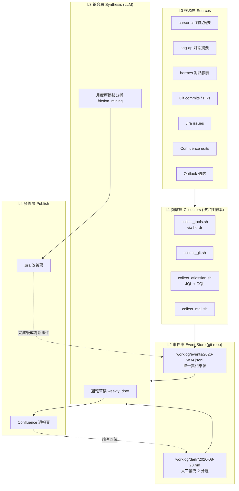

# AI 工具鏈系統架構設計：自動化週報與長期改善迴路

> 版本 v1 ・ 2026-08-23
> 目標：(1) 週報自動化產出 (2) 建立能持續發現「下一個該自動化什麼」的迴路

---

## 0. 前提與假設

本文根據既有工具現況設計。以下幾點是**假設**，若不成立請告知，架構的分層不變、只需換掉對應的 collector：

| # | 假設 | 若不成立的影響 |
|---|---|---|
| A1 | `herdr`（已能整合三個工具的彙整層）＝ hermes 側的整合能力，可讀到 cursor / sng-ap / hermes 的對話摘要 | 需自建 collector 從各工具的本地 session 檔撈取，Phase 1 多 1–2 天 |
| A2 | `sng-ap` 雖無外網，但內網可達 Jira / Confluence API | 改由 cursor-cli 或本機腳本負責 Atlassian 讀寫，sng-ap 只做內部語意分析 |
| A3 | Outlook 可用 Graph API 或本機規則匯出（每週信件） | 退化為手動貼入 `inbox/` 資料夾，其餘流程不變 |
| A4 | hermes 配額 200 次/月 為硬上限 | 見 §5 配額預算表 |

---

## 1. 問題定義：瓶頸不在「寫」，在「素材」

寫週報之所以每週都痛，不是因為文筆，而是因為**素材散在六個地方、且格式不一致**：

```
cursor 對話 ─┐
sng-ap 對話 ─┼─→ 你的短期記憶（會蒸發）─→ 週五晚上憑印象重組 ─→ 週報
hermes 對話 ─┤
Jira/Conf ───┤
Outlook ─────┘
```

所以核心設計不是「做一個週報產生器」，而是**把工作痕跡在產生的當下就固化成結構化事件**。週報只是這批事件的一次投影；月度改善建議、季度績效敘事、KA 知識沉澱，都是同一批事件的其他投影。

> **一句話架構：一次捕捉，多次投影（Capture once, project many）。**

---

## 2. 五條設計原則

1. **事件為最小單位（Event as the unit）**
   不記錄「這週做了什麼」，而是記錄「這件事發生了」。週報 = 對事件流的彙總，不是對記憶的回憶。

2. **Git 是真相來源，Confluence 是發佈端**
   兩者職責必須分離。Confluence 適合人讀、適合分享、適合你既有的習慣；但它對 agent 而言是**很差的讀取介面**（API 慢、格式雜、版本難 diff）。所以：
   - 真相來源 → 一個 `worklog/` git repo，純文字 JSONL + Markdown
   - 發佈端 → Confluence（自動產生頁面）
   這樣任何一個工具（cursor / ap / hermes）都能用 `cat`/`grep` 直接吃到全部歷史，零 API 成本。

3. **便宜的先做：決定性腳本做 80%，LLM 只做綜合**
   git log、Jira JQL、Confluence CQL、PR 清單，這些都是**確定性資料**，用腳本抓就好，不要浪費 LLM 配額也不要冒幻覺風險。LLM 只負責它真正擅長的：把 40 條事件濃縮成 5 句人話。

4. **資料邊界明確化**
   每個事件帶 `sensitivity` 欄位。標記 `internal` 的內容**只能**流向 sng-ap，永不進入 hermes / cursor 的外部模型。這條規則寫進腳本，不是靠自律。

5. **AI 起草，人寫結論**
   週報的前三行（本週成果 / 風險 / 下週重點）永遠由你親手寫。AI 產生的是中段的事實清單。這是週報可信度的保命符——一旦全自動，讀者兩週內就會停止閱讀。

---

## 3. 架構分層



**關鍵在 L2。** 只要 L2 存在且乾淨，L3/L4 換任何模型、任何工具都是可替換的實作細節。先把 L2 做出來，其他都是加分題。

---

## 4. 事件 Schema（L2 的契約）

`worklog/events/YYYY-Www.jsonl`，一行一個事件：

```json
{
  "ts": "2026-08-23T14:05:00+08:00",
  "source": "git|jira|confluence|cursor|ap|hermes|outlook|manual",
  "type": "commit|pr|ticket|doc|decision|blocker|learning|meeting|friction",
  "project": "PROJ-A",
  "ref": "PROJ-1234 | <url> | <sha>",
  "title": "一行說明，動詞開頭",
  "detail": "2-4 句，寫給三個月後的自己看",
  "effort": "S|M|L",
  "outcome": "done|in_progress|blocked|dropped",
  "sensitivity": "internal|public",
  "tags": ["automation", "perf"]
}
```

**欄位設計理由（每個欄位都要有存在的必要）：**

- `type: decision` — 決策絕不能只活在聊天記錄裡。任何一個「我們決定用 X 不用 Y」，當下就要落一筆。這是三個月後最值錢的資料。
- `type: friction` — 這是**長期改善迴路的燃料**（見 §10）。任何「這件事比它該有的樣子更麻煩」的時刻，記一筆。
- `effort` 只用 S/M/L，不要記工時。精確度沒有價值，成本卻很高，會直接殺死習慣。
- `sensitivity` — 原則 4 的執行點，由腳本讀取決定路由。
- `outcome` — 讓「本週卡住的事」能自動被抽出來，這通常是週報中主管最在意、你最容易忘記寫的一段。

---

## 5. 工具分工路由表

三個工具能力與限制不同，**不該混用**。建議固定路由：

| 任務 | 主用工具 | 理由 |
|---|---|---|
| 日常寫程式、重構、除錯 | **cursor-cli** | 編輯器整合最好，是事件流的最大生產者 |
| 內部程式碼/文件的深度推理、內部敏感內容 | **sng-ap** (opus 4.8 + KA) | 模型最強且有 KA；`sensitivity: internal` 的內容**只能**走這條 |
| 需要外部資料的調研、跨工具彙整、週報綜合 | **hermes** | 唯一能同時整合三工具 + 有外網 + 有 vision |
| 截圖／白板／架構圖轉文字 | **hermes** (vision) | 唯一具備 vision |
| 確定性資料抓取（git/Jira/Conf） | **腳本，不用 LLM** | 原則 3 |

### hermes 配額預算（200 次/月 ≈ 46 次/週）

配額是這個系統唯一的硬性稀缺資源，必須明確編列，否則月底會沒得用：

| 用途 | 頻率 | 月用量 |
|---|---|---|
| 週報綜合（草稿 + 一次修訂） | 2 次/週 | ~9 |
| 月度摩擦點分析 | 3 次/月 | 3 |
| vision（圖轉文字） | 隨需 | ~8 |
| 外部調研 ad-hoc | 隨需 | ~40 |
| **合計** | | **~60** |

→ 週報自動化本身只吃掉配額的 **6%**（12/200）。這代表**配額不是限制因素**，可以放心把 hermes 當作綜合層主力；剩餘 140 次仍可自由運用。

> 若 sng-ap 的 quota 之後放寬，可把週報綜合改由 sng-ap 執行（模型更強且合規邊界更安全），hermes 退回純外部調研角色。架構不需改動——這正是 L2/L3 分離的價值。

---

## 6. 使用習慣（這一節才是真正決定成敗的部分）

架構可以一天寫完，習慣要三週才長出來。建議節奏：

### 6.1 對話開場慣例（成本最低、回報最高的一條）

**每一個 AI 對話的第一行，固定寫：**

```
[PROJ-1234] 目標：<一句話>
```

為什麼這條這麼重要：所有工具的對話摘要功能，輸出都是無結構的散文，**無法自動歸屬到某個工作項目**。只要第一行有票號，任何摘要器的輸出都能被一個 regex 自動打上 `project` 與 `ref`。這一個習慣，讓 L1 的 `collect_tools.sh` 從「不可能」變成「二十行腳本」。

### 6.2 每日收工儀式（2 分鐘）

下班前執行 `worklog eod`：

1. 腳本自動抓：今日 commits、PR、Jira 狀態變更、Confluence 編輯、三工具對話摘要
2. 產生 3–5 條候選事件，開在編輯器裡
3. **你只做兩件事**：刪掉雜訊、補上「今天哪裡卡住 / 哪裡覺得麻煩（friction）」
4. commit

> 2 分鐘是設計上限，不是估計值。超過 2 分鐘的儀式撐不過三週。若發現要花 10 分鐘，代表 L1 抓得不夠、或你在追求不必要的精確度。

### 6.3 每週彙整（週五 16:00 或週一 09:30，15 分鐘）

1. 跑 `worklog weekly` → hermes 依 §8 的鎖定 prompt 產出草稿
2. **你親手寫前三行**：本週成果 / 風險與阻礙 / 下週重點
3. 掃過中段事實清單，刪減、修語氣
4. 發佈到 Confluence

### 6.4 每月改善回顧（30 分鐘）

拉四週的 `type: friction` 事件做分群 → 產出排序後的自動化 backlog（見 §10）。

### 6.5 每季

同一批事件重新投影成績效敘事 / OKR 對照。**此時你不需要回想任何事**——這是整套系統最大的隱性回報，比週報自動化本身值錢。

---

## 7. Confluence 結構與模板

既然你習慣用 Confluence 做紀錄，就讓它做它擅長的事：**人讀的發佈端與長期歸檔**。

### 頁面樹

```
<Your Space>
└── Work Log
    ├── Weekly Reports
    │   └── 2026
    │       ├── 2026-W34  ← 自動產生
    │       └── 2026-W35
    ├── Decisions          ← type:decision 事件的月度彙整
    └── Improvement Backlog ← §10 產出
```

### 週報模板（固定結構，不要每週即興發揮）

固定結構有三個好處：讀者知道去哪裡找、腳本能解析回讀、季度彙整可用 Confluence macro 直接 rollup。

```markdown
# <Week> (YYYY-MM-DD ~ YYYY-MM-DD)

## 本週成果        ← 人工，3–5 條，每條附 Jira/PR 連結
## 風險與阻礙      ← 人工，沒有就寫「無」，不要省略此段
## 下週重點        ← 人工，3 條以內
---
## 詳細活動        ← AI 產生，依 project 分組
## 決策紀錄        ← 自動：本週 type:decision
## 觀察到的摩擦點  ← 自動：本週 type:friction
```

**Labels（務必打）：** `weekly-report`, `2026-w34`, `<team>`, `<project>`
標籤是之後所有 rollup 與檢索的基礎，沒打標籤的頁面等於沒寫。

---

## 8. Prompt 資產

Prompt 要**版本控管**（放 `worklog/prompts/`），不要每次重打。每次改 prompt 就是一次 commit，日後能回溯「為什麼週報風格變了」。

### `prompts/weekly_draft.md`

```
你是我的工作紀錄彙整助手。以下是我本週的結構化事件流（JSONL）。

任務：產生週報的「詳細活動」段落。

規則：
1. 依 project 分組，每組最多 5 條
2. 每條格式：<動詞開頭的一句話> (<ref 連結>)
3. 合併同一件事的多筆事件（例如 3 個 commit + 1 個 PR = 1 條）
4. outcome 為 blocked 的事件，單獨列在最後「阻礙」小節
5. 不要評價、不要形容詞、不要「成功地」「順利地」
6. 不確定的內容不要寫，寧可漏掉也不要編造
7. 若某事件資訊不足以寫成一句話，列在最後「需要我補充」清單

輸出：Markdown，不要前言與結語。

事件流：
<<EVENTS>>
```

### `prompts/friction_mining.md`

```
以下是我過去四週標記為 friction 的事件。

任務：找出反覆出現的模式，產出自動化機會清單。

每一項請包含：
- 模式描述（一句話）
- 出現次數與涉及的 ref
- 每次約略耗損（依 effort 欄位推估）
- 建議的自動化做法（具體到工具層級）
- 預估投入 vs 每月可回收時間

依「每月可回收時間 ÷ 預估投入」由高到低排序。
只列出比值 > 3 的項目；其餘歸為「暫不處理」並簡述原因。
```

### `prompts/eod_extract.md`

```
以下是我今天與各 AI 工具的對話摘要、git log、Jira 變更。

任務：抽取成事件 JSONL，遵循 schema（見 worklog/SCHEMA.md）。

規則：
1. 只抽取「產生了成果物」的活動：commit / PR / 文件 / 決策 / 明確結論
2. 探索性的來回討論，若無結論則忽略
3. 對話中出現「決定」「改用」「不採用」等字樣 → type: decision
4. 對話中出現「又要手動」「很煩」「每次都要」→ type: friction
5. 無法判斷 project 時，project 填 null，不要猜

輸出：純 JSONL，無其他文字。
```

---

## 9. 分階段落地路徑

不要一次做完。每個 Phase 都必須**獨立產生價值**，這樣中途停下來也不虧。

| Phase | 期程 | 內容 | 完成判準 |
|---|---|---|---|
| **0** | 第 1 週 | **不寫任何程式碼。** 手動維護 `daily/*.md`，執行 §6.1 對話開場慣例 + §6.2 收工儀式 | 連續 5 個工作日有紀錄 |
| **1** | 第 2–3 週 | 寫 collectors：git / Jira JQL / Confluence CQL → JSONL。cron 每日 18:00 | 事件流 80% 自動產生 |
| **2** | 第 4–5 週 | 接 herdr 拉三工具對話摘要；hermes 跑 `weekly_draft`；人工貼到 Confluence | 週報產出時間 < 15 分鐘 |
| **3** | 第 6–7 週 | Confluence API 自動建頁；Outlook 匯入 | 零手動複製貼上 |
| **4** | 第 8 週+ | `friction_mining` 月度自動跑，產出直接開 Jira 改善票 | 改善迴路閉環 |

**Phase 0 不可跳過。** 先用手動證明這個習慣你撐得住，再投入工程。順序反過來的話，最常見的結局是：一套漂亮的 pipeline 跑在空無一物的事件流上。

---

## 10. 長期改善機會的探勘機制

這是第二個目標，也是多數人做不到的部分——因為「發現改善機會」通常靠靈光一閃，不可靠、不累積。

把它變成資料問題：

```
日常標記 friction（幾乎零成本，收工儀式順手做）
  ↓
月度分群：同一個 friction 出現 ≥ 3 次 → 升級為「候選」
  ↓
量化：出現頻率 × 單次耗損 = 每月耗損
  ↓
排序：每月可回收時間 ÷ 預估自動化投入
  ↓
比值 > 3 → 開 Jira 改善票，進入正常工作流
  ↓
完成後成為新事件 → 下個月的資料點
```

**為什麼這樣有效：** 你不需要「想出」改善機會，只需要在當下**記下不爽**——這是人類非常擅長的事。分析與排序交給每月一次的批次處理。改善機會從此變成一個**穩定產出的管線**，而不是靈感。

---

## 11. 度量指標

系統本身也要有回饋。每月看四個數字：

| 指標 | 定義 | 起始 | 三個月目標 |
|---|---|---|---|
| 週報產出時間 | 從開始到發佈 | ~60 分 | < 15 分 |
| 事件覆蓋率 | 有事件紀錄的工作日 ÷ 工作日 | — | > 90% |
| 自動擷取比例 | 自動事件 ÷ 總事件 | 0% | > 80% |
| 改善票完成數 | 每月從 friction 轉出並完成 | 0 | ≥ 2 |

若三個月後「週報產出時間」沒有明顯下降，**問題幾乎一定在 L1/L2（素材不夠），不在 L3（prompt 不好）**。不要在調 prompt 上浪費時間，回去補 collector。

---

## 12. 失敗模式與對策

| 失敗模式 | 徵兆 | 對策 |
|---|---|---|
| **儀式崩潰** | 收工儀式開始跳過 | 砍到 2 分鐘以內；降低精確度要求；`effort` 只填 S/M/L |
| **週報變罐頭** | 讀者不再回應 | 前三行必須人工；AI 只寫中段事實 |
| **對話摘要雜訊過高** | 事件流塞滿無意義探索 | 用 `eod_extract.md` 規則 1：只留有成果物的活動 |
| **資料越界** | 內部內容進了外部模型 | `sensitivity` 欄位由腳本強制路由，不靠自律 |
| **配額耗盡** | 月中 hermes 用完 | 見 §5 預算；且 L1/L2 為純腳本，配額歸零時系統仍可運作，只是少了綜合 |
| **Confluence 當真相來源** | 開始直接改 Confluence 頁面 | 明令：Confluence 唯讀（對你而言），要改改 git repo 再重新發佈 |

---

## 13. 建議的下一步

1. **今天**：建 `worklog/` repo，放入 `SCHEMA.md` 與三個 prompt 檔
2. **明天起連續五天**：只做 §6.1（對話開場票號）+ §6.2（收工 2 分鐘），純手動
3. **第二週**：確認習慣站穩後，開始寫 `collect_git.sh` 與 `collect_atlassian.sh`

需要的話，可以接著把 Phase 1 的 collectors 與 `worklog` CLI 直接實作出來。
